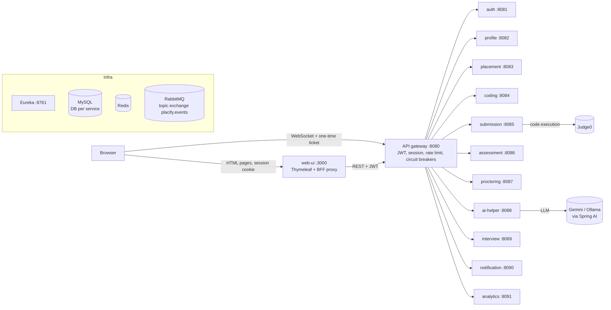

# CareerPilot architecture

## 1. Big picture

Every box is a Spring Boot 3.5 application written in Java 21. Services register in Eureka and call each other
with a load-balanced `RestClient`; asynchronous work goes over RabbitMQ.

## 2. Services and data ownership

| Service | Owns (database) | Responsibilities |
|---|---|---|
| **auth** | `placify_auth`: users, login history, OTP codes, company sign-ups | Role portals (student/company/TPO/admin), captcha, lockout, e-mail OTP, two-step login, single session, CSV/Excel student import, company approval, block/unblock, JWT issue |
| **profile** | `placify_profile`: student & company profiles, ATS results | Profiles, photo/resume upload (Tika + PDFBox), completeness, ATS scoring (keywords, semantic similarity, structure, impact), AI resume auto-fill |
| **placement** | `placify_placement`: jobs, rounds, applications, round results, policy, calendar, attendance, slots, offers, certificates | Job approval & tiers, 12 eligibility rules, AI match score, multi-round pipeline, interview slots (optimistic locking), offers, off-campus verification, PDF certificate with QR code |
| **coding** | `placify_coding`: questions, test cases, ratings, contests, badges | Problem bank, Elo-style ratings, adaptive recommendations, contests with Redis leaderboards, badges, hall of fame |
| **submission** | `placify_submission`: submissions, per-test results, plagiarism checks | Judge0 integration (callbacks + polling), verdicts, AI code review, plagiarism (JPlag + winnowing) |
| **assessment** | `placify_assessment`: MCQs, tests, pools, attempts | MCQ bank (manual + AI), randomised tests, timed attempts, auto-submit, grading, cut-offs |
| **proctoring** | `placify_proctoring`: sessions, violations | Webcam frame analysis in Java: OpenCV Haar cascades (face, eyes, profile), DJL face matching, YOLOv5 phone detection, browser events, trust score, termination |
| **ai-helper** | `placify_ai`: tutor chats, mock interviews | Spring AI (tutor with progressive hints, code review, mock interviews, MCQ/interview question generation, resume parsing, experience summaries) and DJL sentence embeddings |
| **interview** | `placify_interview`: scorecards, experiences, votes, AI prep summaries | Structured interview scorecards, interview experiences with moderation, company prep hub |
| **notification** | `placify_notification`: notifications, announcements, e-mail log | In-app notifications, Thymeleaf e-mails, announcements, STOMP WebSocket (notifications, proctoring warnings, live leaderboards) |
| **analytics** | `placify_analytics`: audit log, readiness snapshots, placement records, historical outcomes | Role dashboards, readiness score, at-risk detection, Tribuo placement prediction, PDF/Excel reports, central audit log |

No service reads another service's database. Cross-service data comes from `/internal/**` endpoints or events.

## 3. Security model

1. **Login** – the web portal posts the login form to `auth` through the gateway. `auth` checks the captcha,
   the portal (a student cannot log in on the TPO portal), lockout (5 failures → 15 minutes), account status and,
   if enabled, sends an e-mail OTP (two-step login). On success it issues a JWT (HS256, claims: user id, login, role,
   name, session id, first-login flag) and stores the session id in Redis (`placify:session:{userId}`).
2. **Single session & inactivity** – a new login replaces the session id, so the older device is logged out. The
   gateway slides the Redis TTL on every request; inactivity beyond `SESSION_TIMEOUT_MINUTES` ends the session.
3. **Gateway** – verifies the JWT and the Redis session, applies coarse role rules and the first-login restriction,
   strips any identity headers sent by the client and adds `X-User-*` headers plus the secret `X-Gateway-Secret`.
4. **Services** – trust identity headers only when the gateway secret (or, for service-to-service calls, the
   internal secret) matches; `/internal/**` requires the internal role; fine-grained checks use `@PreAuthorize` and
   ownership checks in the services.
5. **Browser** – the JWT never reaches JavaScript: it lives in the server-side HTTP session of `web-ui`
   (HttpOnly cookie), and pages call the API through the CSRF-protected `/bff` proxy. Strict CSP, frame-deny and
   same-origin referrer headers. WebSockets use a one-time 60-second ticket.
6. **Audit** – sensitive actions are annotated with `@Audited`; an aspect publishes `AuditEvent`s that `analytics`
   stores. Admins search and export them (CSV export is formula-injection safe).

## 4. Events (RabbitMQ topic exchange `placify.events`)

| Routing key | Producer → consumers | Purpose |
|---|---|---|
| `notification.send` | any → notification | In-app + e-mail notifications (`ROLE:TPO` style audiences are expanded) |
| `student.imported` | auth → profile | Create the profile of an imported student |
| `company.approved` | auth → profile | Create the company profile |
| `assessment.completed` | assessment → placement, analytics | Move candidates through test rounds; refresh readiness |
| `interview.evaluated` | interview → placement | Apply scorecard results to interview rounds |
| `submission.judged` | submission → coding, assessment | Ratings, badges, contest scores, test coding scores |
| `proctoring.terminate` | proctoring → assessment | End an attempt after too many violations |
| `proctoring.warning` | proctoring → notification | Live warning on the student's exam screen |
| `proctoring.frame` | proctoring → proctoring worker | Asynchronous camera-frame analysis (30 s TTL) |
| `leaderboard.updated` | coding → notification | Live contest leaderboard |
| `student.placed` | placement → analytics | Long-term placement records |
| `audit.log` | any → analytics | Central audit trail |

Events are published only after the database transaction commits (`TransactionSynchronization`).

## 5. Resilience

* Gateway: Redis rate limiter per client IP, Resilience4j circuit breakers with friendly fallbacks, 90 s time limit for AI calls.
* Service calls to optional features (AI, analytics, readiness) use circuit breakers with fallbacks, so a missing
  AI key or a down service degrades a feature instead of breaking the page.
* AI: the embedding model loads in the background; until then (or without the model) a term-frequency cosine is used.
* Proctoring: phone detection and face matching degrade gracefully when the DJL models are unavailable.
* Judge0: callbacks when reachable, polling otherwise.

## 6. Readiness score and prediction

`ReadinessCalculator` (analytics) combines coding practice (30), aptitude (20), resume ATS (15), profile (10),
AI mock interviews (15) and contests (10). The placement-chance model is a Tribuo logistic regression on CGPA,
backlogs and those preparation areas. It starts from synthetic history and improves as the TPO records finished
seasons (`POST /api/analytics/tpo/model/record-season`). It is retrained nightly.
